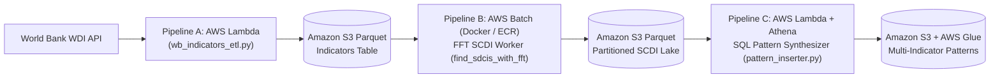

# QGI 5.0 — Cloud-Native AWS Lambda, Docker Batch FFT & Athena Pipeline (2025–2026)

**Generation 5.0 of 7.0** · Consolidates **`AminAlAit/qgi-pipeline-a-indicator-extractor`**, **`AminAlAit/qgi-pipeline-b-scdi-finder`**, and **`AminAlAit/qgi-pipeline-c-pattern-synthesizer`** · **Current Production Platform:** [**`AminAlAit/qgi` (QGI 7.0)**](https://github.com/AminAlAit/qgi) ([qgintelligence.com](https://qgintelligence.com))

---

## Overview

In late 2025, computing pairwise country-indicator correlations locally in **QGI 4.0** hit a single-machine CPU and storage wall. **QGI 5.0** was the first cloud-native AWS re-architecture of the platform — decomposing the ingestion, correlation compute, and multi-indicator synthesis stages into three decoupled AWS microservices backed by an **Amazon S3 Parquet data lake**, **Amazon ECR**, **AWS Batch**, and **Amazon Athena**:

1. **`qgi-pipeline-a-indicator-extractor/`** *(Originally `AminAlAit/qgi-pipeline-a-indicator-extractor`)*: Serverless **AWS Lambda** ingestion service polling the World Bank API (`wbgapi`) via YAML configuration (`wb_config.yaml`) and writing normalized Parquet indicator partitions to S3.
2. **`qgi-pipeline-b-scdi-finder/`** *(Originally `AminAlAit/qgi-pipeline-b-scdi-finder`)*: Containerized **Docker + AWS Batch** compute worker (`find_sdcis_with_fft()` in `src/scdi_finder.py`) that replaced brute-force time-domain sliding loops with **Fast Fourier Transform (FFT)** cross-correlation using `scipy` and `numba`, writing Snappy-compressed Parquet partitions (`s3://.../scdis/`) and registering Glue/Athena partitions automatically.
3. **`qgi-pipeline-c-pattern-synthesizer/`** *(Originally `AminAlAit/qgi-pipeline-c-pattern-synthesizer`)*: Serverless **AWS Lambda + Amazon Athena** synthesizer (`src/pattern_inserter.py`) executing distributed SQL `CREATE TABLE AS SELECT (CTAS)` and `INSERT INTO` joins over S3 Parquet tables to synthesize multi-indicator bilateral patterns at cloud scale.

All three original repositories — including their full commit histories and standalone branches (`qgi-pipeline-a-indicator-extractor/main`, `qgi-pipeline-b-scdi-finder/main`, and `qgi-pipeline-c-pattern-synthesizer/main`) — are preserved in this unified repository.

---

## Cloud Architecture & Key Engineering Highlights



### 1. Pipeline A — Serverless World Bank Ingestion (`qgi-pipeline-a-indicator-extractor/`)
- **Declarative Extraction (`src/qgi_pipeline_a_indicator_extractor/wb_config.yaml` & `wb_indicators_etl.py`):** Configured indicator batches, country ISO filters, and S3 destinations via YAML; executed via `local_runner.py` locally or AWS Lambda in the cloud.
- **Unit Test Suite (`tests/a_indicator_extractors/test_wb_indicators_etl.py`):** Pytest suite validating schema normalization and missing-value handling.

### 2. Pipeline B — FFT-Accelerated AWS Batch Worker (`qgi-pipeline-b-scdi-finder/`)
- **Algorithmic Speedup (`src/scdi_finder.py`):** Implemented `find_sdcis_with_fft()` with `scipy.signal` and `numba` JIT compilation to vectorize lagged cross-correlation across all country pairs and window lengths (`min_period_len` to `max_period_len`), cutting compute time by orders of magnitude compared to QGI 4.0's nested loops.
- **Containerized CI/CD (`Dockerfile`, `.github/workflows/build-push-ecr.yml`):** Packaged the Python 3.11 scientific stack (`numpy`, `scipy`, `numba`, `pyarrow`, `boto3`) into an ECR container image deployed to AWS Batch via GitHub Actions OIDC.

### 3. Pipeline C — Distributed Athena Pattern Synthesis (`qgi-pipeline-c-pattern-synthesizer/`)
- **Push-Down SQL Synthesis (`src/pattern_inserter.py`, `src/athena_runner.py`):** Instead of pulling gigabytes of SCDI Parquet files into Python memory to join multi-indicator patterns, Pipeline C pushed the join down to **Amazon Athena**, orchestrating parameterized SQL queries from Lambda and writing partitioned output tables directly back to S3.

---

## Repository Structure

```text
qgi-5.0/
├── qgi-pipeline-a-indicator-extractor/        # Stage A: Serverless AWS Lambda WDI Extractor
│   ├── src/qgi_pipeline_a_indicator_extractor/
│   │   ├── wb_indicators_etl.py               # Core World Bank API -> S3 Parquet ETL
│   │   └── wb_config.yaml                     # Declarative indicator & S3 target config
│   ├── tests/                                 # Pytest unit tests
│   ├── local_runner.py                        # Local execution harness
│   └── pyproject.toml                         # Poetry configuration
│
├── qgi-pipeline-b-scdi-finder/                # Stage B: Dockerized AWS Batch FFT SCDI Worker
│   ├── .github/workflows/build-push-ecr.yml   # GitHub Actions OIDC -> Amazon ECR build pipeline
│   ├── src/
│   │   ├── main.py                            # Batch container entry point & S3 partition writer
│   │   ├── scdi_finder.py                     # FFT-accelerated correlation engine (find_sdcis_with_fft)
│   │   └── athena_partition.py                # Automated Glue/Athena partition registration
│   ├── tests/                                 # Unit tests for FFT SCDI numerical accuracy
│   ├── Dockerfile                             # Production AWS Batch container definition
│   └── pyproject.toml                         # Poetry dependencies (numpy, scipy, numba, pyarrow)
│
└── qgi-pipeline-c-pattern-synthesizer/        # Stage C: AWS Lambda + Athena Pattern Synthesizer
    ├── src/
    │   ├── main.py                            # Lambda handler & batch orchestrator
    │   ├── pattern_inserter.py                # Athena CTAS / INSERT multi-indicator join builder
    │   └── athena_runner.py                   # Boto3 Athena query execution & polling client
    ├── tests/                                 # Unit tests for SQL synthesis & Athena polling
    └── pyproject.toml                         # Poetry configuration
```

---

## Why We Evolved from QGI 5.0 to QGI 6.0 & 7.0

- **Need for Declarative Multi-Account IaC & Orchestration:** Managing Lambda functions, Batch compute environments, S3 buckets, and Athena tables across manual scripts highlighted the need for full **Terraform Infrastructure-as-Code**, **AWS Step Functions** state-machine orchestration, and isolated **AWS Organizations** accounts (Management, Staging, QA, Prod) — which were built in **QGI 6.0** and unified into the **QGI 7.0** production monorepo ([`AminAlAit/qgi`](https://github.com/AminAlAit/qgi)).

---

## QGI Generational Roadmap (`v1.0` → `v7.0`)

| Generation | Year | Repository | Original Name(s) | Architectural Milestone |
| :--- | :--- | :--- | :--- | :--- |
| **QGI 1.0** | 2023 | [`AminAlAit/qgi-1.0`](https://github.com/AminAlAit/qgi-1.0) | `trojan`, `trojan-streamlit` | Initial pairwise country correlation engine & first Streamlit UI |
| **QGI 2.0** | 2023 | [`AminAlAit/qgi-2.0`](https://github.com/AminAlAit/qgi-2.0) | `trojan-2.0` | Poetry-packaged ETLP pipeline, `Index` OOP hierarchy & STUMPY matrix profiles |
| **QGI 3.0** | 2024 | [`AminAlAit/qgi-3.0`](https://github.com/AminAlAit/qgi-3.0) | `qgi` (2024), `qgi-streamlit`, `qgi-local` | Multi-page Streamlit analytical terminal backed by relational SQLite/MySQL queries |
| **QGI 4.0** | 2025 | [`AminAlAit/qgi-4.0`](https://github.com/AminAlAit/qgi-4.0) | `qgi-4.0` | Formalization of the SCDI metric (Spearman + Cross-Correlation + DTW), Pipelines A–E & X Bot v1 |
| **QGI 5.0** *(Here)* | 2025–2026 | **`AminAlAit/qgi-5.0`** | `qgi-pipeline-a/b/c` | First AWS cloud migration: Serverless Lambda ETL, Dockerized AWS Batch FFT worker & Athena CTAS |
| **QGI 6.0** | 2026 | `AminAlAit/qgi-6.0` | `qgi-aws-tf`, `qgi-infra`, `qgi-pipeline`, `qgi-data`, `qgi-ml`, `qgi-frontend`, `qgi-docs` | 4-account AWS Organization (14.3B FFT correlations), 42-model Trajectory Engine & Next.js 16 terminal |
| **QGI 7.0** *(Active)* | 2026–Present | [**`AminAlAit/qgi`**](https://github.com/AminAlAit/qgi) | `qgi`, `qgi-docs` | Unified production monorepo & live analytical terminal at [qgintelligence.com](https://qgintelligence.com) |
